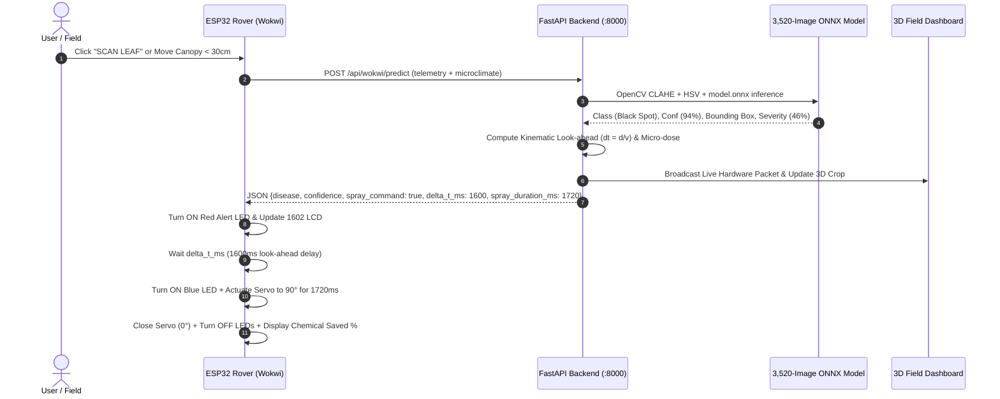

# CropGuard AI · Wokwi IoT Hardware-in-the-Loop (HIL) Rover Integration

This folder contains the complete simulated **ESP32 Edge Computing & Precision Actuator Project** for CropGuard AI, designed to run in **[Wokwi](https://wokwi.com)** or the **Wokwi VS Code / Antigravity Extension**.

---

## 🛠️ Hardware Circuit Architecture (`diagram.json`)

| Component | Part ID | Wokwi Model | ESP32 GPIO | Purpose |
|---|---|---|---|---|
| **Microcontroller** | `esp` | `wokwi-esp32-devkit-v1` | — | Dual-core Wi-Fi & Edge Logic Controller |
| **Ultrasonic Distance** | `sonar` | `wokwi-hc-sr04` | `TRIG: D5`, `ECHO: D18` | Measures canopy proximity ($< 30\,\text{cm}$ triggers auto-scan) |
| **Temp & Humidity** | `dht` | `wokwi-dht22` | `DATA: D4` | Evaluates microclimate fungal spore risk ($> 75\%$ RH) |
| **Manual Scan Button** | `btn_scan` | `wokwi-pushbutton` | `PIN: D19` (`INPUT_PULLUP`) | Instant on-demand leaf capture & diagnosis |
| **Auto Patrol Switch** | `sw_auto` | `wokwi-slide-switch` | `PIN: D23` (`INPUT_PULLUP`) | Toggles continuous rover patrol scanning mode |
| **Precision Spray Valve** | `servo` | `wokwi-servo` | `PWM: D13` | Micro-dose valve ($0^\circ$ closed, $90^\circ$ spraying) |
| **Spray Actuator LED** | `led_spray` | `wokwi-led` (Blue) | `PIN: D2` (via $220\,\Omega$) | Lights up when nozzle is actively spraying |
| **Disease Alert LED** | `led_alert` | `wokwi-led` (Red) | `PIN: D15` (via $220\,\Omega$) | Flashes when pathogen is detected by the AI model |
| **I2C Status Display** | `lcd` | `wokwi-lcd1602` | `SDA: D21`, `SCL: D22` | Live diagnosis, confidence %, and spray status |

---

## 🚀 How to Run in 3 Easy Steps

### Option A: Run in Browser at Wokwi.com (Zero Install)
1. Go to **[https://wokwi.com/projects/new/esp32](https://wokwi.com/projects/new/esp32)**.
2. In the code editor tab, replace the code with the contents of **`wokwi/sketch.ino`**.
3. In the `diagram.json` tab, replace the contents with **`wokwi/diagram.json`**.
4. In the `libraries.txt` tab, add the libraries from **`wokwi/libraries.txt`**.
5. Ensure your CropGuard FastAPI backend is running on your machine:
   ```bash
   python -m uvicorn backend.main:app --host 0.0.0.0 --port 8000
   ```
6. Click the green **Play** button in Wokwi!
   *Note: In Wokwi simulated Wi-Fi, `host.wokwi.internal:8000` automatically routes to your computer's `localhost:8000`.*

---

### Option B: Run in VS Code / Antigravity with Wokwi Extension
1. Install the official **Wokwi** extension from the Marketplace.
2. Open this repository in your editor.
3. Open `wokwi/diagram.json`.
4. Press `F1` and select **Wokwi: Start Simulator**.

---

## ⚡ How the HIL Closed-Loop Works


